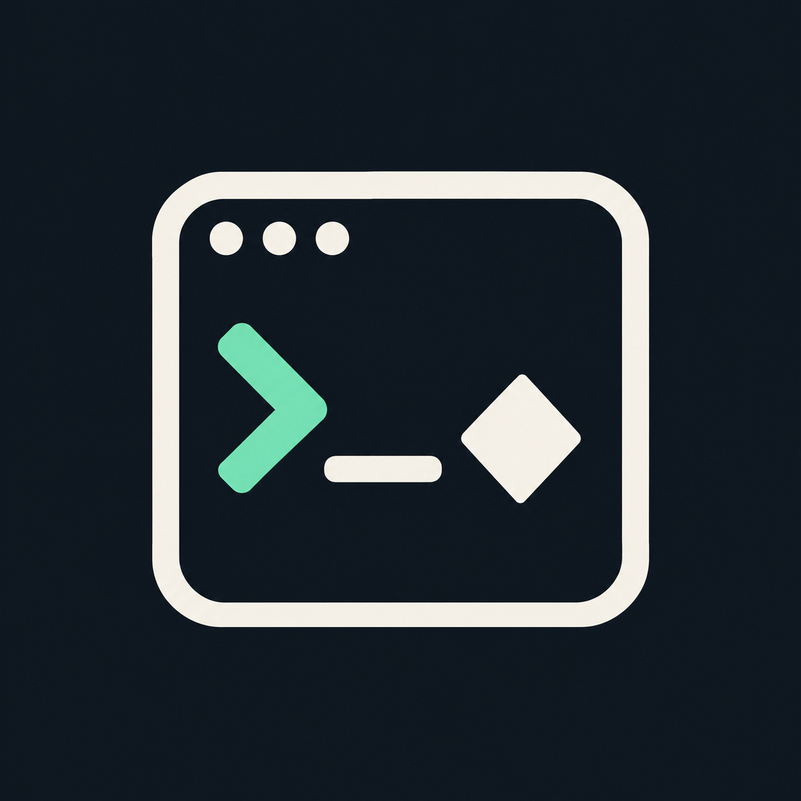

<p align="center">
  
</p>

<h1 align="center">TableCard</h1>

<p align="center"><strong>Your terminal. Your game table.</strong></p>

<p align="center">
  Twelve games. Shared rooms and chat. One terminal.
</p>

<p align="center">
  <a href="https://github.com/17hwliao/Table-Card/releases/latest">Download</a> ·
  <a href="#quick-start">Quick start</a> ·
  <a href="#games">Games</a> ·
  <a href="#build-from-source">Build from source</a> ·
  <a href="#documentation">Documentation</a>
</p>

<p align="center">
  <a href="https://github.com/17hwliao/Table-Card/releases/latest"></a>
  <a href="go.mod"></a>
  <a href="LICENSE"></a>
</p>

---

TableCard is a collection of multiplayer tabletop games, survival games, and text adventures built around a full terminal interface. Choose a game, host a room, chat with friends, and play using your keyboard or mouse. A Go server validates multiplayer actions and synchronizes each player's view over WebSocket.

**Interface language:** game screens, rules, and story text are currently primarily in Chinese. This README is in English. Required choices use numbers or ASCII letters; English nicknames and numbered chat phrases let you play without a Chinese input method. Use a terminal font that can display Chinese characters.

## Why TableCard?

| Bring friends | Practice at your pace | Keep setup small |
| :--- | :--- | :--- |
| Shared rooms, online presence, and chat across games. | Rule-based bots, offline Snake, and a local text adventure. | Portable Windows host and player packages, with music included. |

<details>
<summary><strong>More about the terminal experience</strong></summary>

- **A terminal from start to finish.** Game selection, rooms, boards, chat, and results share the same terminal interface.
- **Play together or practice.** Ten networked modes, rule-based Sunjiajia bots, and two games with offline play.
- **One server, many tables.** Friends can play different games while sharing online presence, server-wide messages, and private chat.
- **Portable Windows downloads.** Separate player and host packages, with music embedded in the client. Players need no Go installation, Docker, Redis, or database.
- **Room-aware controls.** Mouse input for boards and planting, keyboard hints, and an explicit terminal-size notice when the full game view cannot fit.

</details>

## Download

Download the ZIP for your role from [GitHub Releases](https://github.com/17hwliao/Table-Card/releases/latest). The current published version is **[v2026.10.26.1](https://github.com/17hwliao/Table-Card/releases/tag/v2026.10.26.1)**.

| Package | Who needs it? | Current download |
| --- | --- | --- |
| **Player client** | Players joining somebody else's server; offline Snake and text adventure are included | [Windows x64 ZIP · 14.62 MiB](https://github.com/17hwliao/Table-Card/releases/download/v2026.10.26.1/Table-Card-Client-Windows-amd64-20261026-093328-31c7d8.zip) |
| **Host / server** | The person running the server; also includes the player client | [Windows x64 ZIP · 17.68 MiB](https://github.com/17hwliao/Table-Card/releases/download/v2026.10.26.1/Table-Card-Host-Windows-amd64-20261026-093328-31c7d8.zip) |
| **Checksums** | SHA-256 values for both ZIPs | [SHA256SUMS](https://github.com/17hwliao/Table-Card/releases/download/v2026.10.26.1/SHA256SUMS-v2026.10.26.1.txt) |

**Extract the entire ZIP before starting.** Keep the launchers, scripts, executable files, and notices together. Use matching client and server releases; stop an old background server before launching an updated one.

## Quick start

### Host a game

1. Extract the **host package**.
2. Double-click `start-table-card.bat` to start or reuse a compatible local server and open a client. To run only the server, use `start-server.bat`.
3. Copy the shareable **LAN IP:port** shown in the launcher window and send it to your friends. The connection address is also saved to `runtime/server-1781-addresses.txt` when using the default port.
4. Choose a game and create a room. Share its **six-digit room code**.
5. Players press `R` to ready up; the host presses `S` to start.

Closing the clients does not stop the background server. To stop a server started by the launcher, run this from the host package directory:

```powershell
./scripts/stop-local-server.ps1 -Port 1781
```

### Join a friend

1. Extract the **player package**.
2. Double-click `join-table-card.bat`.
3. Enter the host's address, such as `192.168.1.20:1781`, and your nickname.
4. Select the same game, choose **Join room**, and enter the room code.

The default port is **TCP 1781**. On the same LAN, use the address shown by the host. The host's firewall and network must allow incoming connections. Internet play requires a reachable host address and port; TableCard does not currently provide a cloud relay or NAT traversal service.

### Play alone

| Entry point | What it opens |
| --- | --- |
| `start-snake.bat` | Offline Snake, without starting a server |
| `start-pokemon.bat` | The text adventure; local adventure remains available if the server is unreachable |
| **Bot practice** in a networked mode's menu | A server-hosted practice game with bots |

The main game selector also offers Snake (`0`) and the text adventure (`P`) when a server is unavailable. Bot practice for the networked modes requires a running server.

<details>
<summary><strong>Advanced launcher options: local clients and custom servers</strong></summary>

### Open several local clients

Run these commands in the **host package** or source checkout:

```powershell
# Start or reuse the local server and open four clients.
./start-table-card.ps1 -Clients 4

# Ask how many clients to open.
./start-table-card.ps1 -PromptClients

# Run only a local server on a chosen port.
./start-table-card.ps1 -ServerOnly -Port 1781

# Connect to another computer's server.
./start-table-card.ps1 -Server 192.168.1.20:1781
```

The launcher checks server compatibility before connecting. In a source checkout it can build the Go executables when needed; portable packages contain prebuilt executables.

</details>

## Games

Press the listed key in the game selector. Networked modes provide room creation, matching, and bot practice.

| Game | Key | Players | Included gameplay |
| --- | :---: | --- | --- |
| **Dou Dizhu** | `1` | 3 | Bidding, landlord versus two farmers, legal combinations, multipliers, and bot practice |
| **Liar's Bar** | `2` | 4 | Hidden cards, bluffing, challenges, elimination, and paced bot turns |
| **Sichuan Mahjong** | `3` | 4 | Blood-battle play, optional three-tile exchange, missing suit, peng/gang/hu, scoring, and configurable house rules |
| **Xiangqi** | `4` | 2 | Clickable Chinese chess, check and mate, repetition adjudication, and a bot |
| **Chess** | `5` | 2 | Castling, en passant, promotion, checkmate, stalemate, and draw detection |
| **Gomoku** | `6` | 2 | A 15×15 board, freestyle five-in-a-row, and a bot |
| **Go** | `7` | 2 | A 19×19 board, captures, positional superko, passing, dead-stone agreement, and Chinese area scoring |
| **UNO** | `8` | 2–4 | A 108-card deck, stacking penalties, jump-ins, 7/0 hand exchange, +4 challenges, house rules, and a 500-point series |
| **Tetris survival** | `9` | 2 or 4 | Identical seven-bag sequences, ghost pieces, shared speed increases, elimination, and spectating |
| **Snake** | `0` | 1, offline | Food, growth, increasing speed, pause/restart, and wall or self-collision |
| **Garden Relay** | `G` | 2 | Real-time 5×9 lawns, ten plants, nine zombie types, mouse planting, and defeated-enemy transfers |
| **Pokémon text adventure** | `P` | 1; optional 2-player interactions | 151 species, Kanto-inspired progression, original side quests, catching, leveling, evolution, player battles, and trades |

<details>
<summary><strong>Tetris survival: timing, scoring, and controls</strong></summary>

### Tetris survival

Every player has a 10×20 board and the same piece sequence. After the opening countdown, the shared level increases **every 20 seconds**, even if nobody clears a line. Gravity speeds up from **1,000 ms to 100 ms per cell**; the fixed lock window also shortens. The last surviving player wins. This is a survival mode without garbage-line attacks.

Use `Left` / `Right` to move, `Up` / `Down` to rotate clockwise / counterclockwise, **`S` to soft-drop**, and `Space` to hard-drop. Opening chat or rules does not pause the match.

</details>

<details>
<summary><strong>Garden Relay: the shared-lawn battle</strong></summary>

### Garden Relay

Defend your own lawn and press `Tab` or `V` to inspect your opponent's live lawn. Every defeated zombie returns at the right edge of the opponent's **same row**, with full health and armor; this repeats on every defeat. There are no lawnmowers. Let a zombie reach the brain and you lose; simultaneous breaches are a draw.

Click a plant card, then a cell on your lawn to plant it. Keyboard selection and the shovel are also supported. Combat continues while inspecting the other lawn, chatting, or reading rules. See the [Garden Relay guide](docs/garden-relay.md) for timings and controls.

</details>

<details>
<summary><strong>Pokémon text adventure: progression and online play</strong></summary>

### Pokémon text adventure

Choose actions with numbers or English letters followed by `Enter`. The adventure combines a Kanto-inspired eight-badge and League route with original side quests, three-shake catching, shops, experience, and evolution. Species facts, level-up moves, growth groups, and twelve sampled wild encounter tables use first-generation Red data; the game is a fan adaptation with simplified systems and original elements.

- `M`: regional map; `C`: city center; `W`: world map; `H`: help.
- `P`: party, experience needed for the next level, evolution conditions, and move details.
- `V`: the opposing trainer's team counts during battle.
- `L`: the online trainer center for mutually accepted battles and trades on the same server.
- `F5`: save; `F9`: music; `Del`: save and return.

For player battles, each participant needs at least 300 coins. The winner gains a net 300 coins and the loser loses 300; a draw refunds the stakes. Leaving or disconnecting counts as a forfeit. Use distinct nicknames and one window per identity. Details and data sources are in the [text adventure guide](docs/pokemon-text-adventure.md).

</details>

## Controls and chat

Follow the current screen's hints: some game-specific keys have different meanings between modes.

| Context | Controls |
| --- | --- |
| Game selector | Arrow keys or the game shortcut; `Enter` to enter; `E` to edit nickname |
| Networked mode menu | `1` match, `2` create, `3` join, `4` bot practice, `5` leaderboard, `6` personal results, `7` rules, `8` back |
| Waiting room | `R` ready, `S` start |
| Board games | Click a piece and destination, or move the keyboard cursor and press `Enter` |
| In a match | `F1` rules, `Del` leave the table, `F2` rematch after the game ends |
| Music | `M` in ordinary screens; `F9` in the text adventure |
| Chat input | `/` open, `Enter` send, `Esc` return to the game |
| Chat scope | `F6` server-wide, `F7` current room, `F8` selected player's private messages |
| Online players | `F4` opens a compact player picker; arrow keys select, `Enter` chooses a private-message recipient |
| Preset phrases | `F3`, then a number to send a Chinese phrase without typing Chinese |
| Exit | `Ctrl+C` |

Chat continues to update while you type. Server-wide messages and private messages work across different games on the same server; room chat stays within that room. At **120 columns or wider**, an online sidebar shows each player's mode, room, and state.

Leaving an active multiplayer match hands your seat to a bot. Disconnected seats are held for 30 seconds before bot takeover; quick matching fills remaining seats with bots after 15 seconds. See the [complete control reference](docs/terminal-controls.md) for individual games.

## Architecture

```text
Terminal clients
  Bubble Tea + Bubbles + Lip Gloss
          |
          | HTTP room requests + WebSocket events
          v
Go server
  Rooms / presence / chat / statistics
          |
          +-- Turn-based game rules and bots
          +-- Real-time Tetris and Garden Relay simulation
          +-- Optional adventure battles and trades

Local client state
  Snake / text adventure / identity / saves / embedded audio
```

| Layer | Implementation |
| --- | --- |
| Language | Go 1.26+ |
| Terminal UI | Bubble Tea v2, Bubbles v2, Lip Gloss v2 |
| Networking | Go `net/http`, `coder/websocket`; multiplayer rules run on the server |
| Bots | Game-specific heuristics under the Sunjiajia bot design; no external AI service required |
| Persistence | Local JSON files for identities, saves, statistics, and adventure social state; live rooms are in memory |
| Audio | Embedded MP3, `beep`, and Oto; music is streamed from embedded files |
| Distribution | Windows portable ZIPs built with PowerShell |

Client and server use default Go runtime soft memory budgets of **64 MiB** and **128 MiB**, with at most two and four execution cores respectively. Existing `GOGC`, `GOMEMLIMIT`, and `GOMAXPROCS` settings take priority. These are runtime budgets, not hard limits on total process memory. See the [memory report](docs/memory-and-test-report.md).

## Build from source

Install **Go 1.26 or later**. The supplied launchers and packaging scripts target Windows; the published portable binaries target Windows x64. Run these commands in the repository root:

```powershell
git clone https://github.com/17hwliao/Table-Card.git
cd Table-Card

go build -o bin/table-card.exe ./cmd/table-card
go build -o bin/table-card-server.exe ./cmd/table-card-server
./start-table-card.ps1 -Clients 1
```

To launch without the wrapper scripts, keep the server running in one terminal and open the client in another:

```powershell
# Terminal 1: listen on the default multiplayer port.
./bin/table-card-server.exe -listen :1781

# Terminal 2: substitute the reachable address printed by your server.
./bin/table-card.exe -server 192.168.1.20:1781 -name Alice
```

### Development checks

```powershell
go test ./...
go vet ./...

# Full test runner, race checks, benchmarks, and launcher checks.
./scripts/test-project.ps1 -Race -Benchmarks -Launchers
```

### Create portable packages

```powershell
./scripts/package-windows.ps1 -Architecture amd64
```

The script writes separate host and client ZIPs into `dist/`, with executable checksums and license notices. An `arm64` build option is also available; the current published packages are x64. Desktop launcher installation is available through `scripts/install-desktop-launcher.ps1`.

## Troubleshooting and current limits

- **Cannot connect:** confirm that the host is running a matching server version, check the displayed IP and TCP port, and allow the connection through the host's firewall. A room code alone does not identify a server.
- **Old modes or a version mismatch:** stop the old background server before starting the new host package. Updating source files does not replace an already running process.
- **Windows reports that the operation was canceled (1223):** the executables are currently unsigned. Verify the release ZIP against its published SHA-256, unblock the downloaded ZIP in Windows file properties, and extract it again. The included `repair-startup.bat` can verify the package's executable checksums and unblock only those files after confirmation; it does not disable system protection. A checksum manifest is not a digital signature.
- **The board does not fit:** enlarge the terminal as directed by the size notice. Not every mode has a fully scrollable game view. Use a font with Chinese glyph support.
- **Rules differ from your local table:** Mahjong and UNO use the project's configurable house rules. Gomoku is freestyle; Xiangqi uses casual repetition rules; Chess has no clock; Go bots do not adjudicate life and death automatically. The [mode status document](docs/mode-migration-status.md) records the precise scope.
- **Local state:** live rooms do not survive a server restart. Snake's high score lasts for the current client run; adventure progress is saved by nickname.

## Documentation

The detailed guides below are currently primarily in Chinese. This English README covers download, setup, core controls, and development entry points.

| Guide | Contents |
| --- | --- |
| [Complete terminal controls](docs/terminal-controls.md) | Menus, keys, mouse actions, and ASCII-only choices for all twelve modes |
| [Mode status](docs/mode-migration-status.md) | Implemented rules, bot behavior, and known limitations |
| [Garden Relay](docs/garden-relay.md) | Plants, zombies, transfer rules, controls, and simulation boundaries |
| [Text adventure](docs/pokemon-text-adventure.md) | Commands, story progression, experience, evolution, encounters, player battles, and trading |
| [Bot design](docs/sunjiajia-design.md) | Sunjiajia decision-making and game integration |
| [Game audio](docs/game-audio.md) | Tracks, source links, authors, licenses, and processing details |
| [Memory and test report](docs/memory-and-test-report.md) | Measurement methods, runtime budgets, and test scope |
| [Recovery and fixes, October 26](docs/recovery-and-fixes-2026-10-26.md) | Recovered features and verified repairs |
| [Full review, October 26](docs/full-review-2026-10-26.md) | Module relationships, confirmed defects, fixes, and verification limits |

To report a problem, [open an issue](https://github.com/17hwliao/Table-Card/issues) with the release version, game mode, terminal size, and reproduction steps. Remove private addresses and personal data from logs before sharing them.

## License and credits

TableCard's source code is distributed under **GNU GPL v3**; see [LICENSE](LICENSE). Dependencies, factual data, music sources, and retained notices are documented in [THIRD_PARTY_NOTICES.md](THIRD_PARTY_NOTICES.md).

The eleven embedded music recordings are adaptations of CC0 music by **Ragnar Random**. Garden Relay currently shares the tavern track. The [audio catalog](docs/game-audio.md) records the individual sources and assignments.

The project's logo, palette, and creation brief are available in the [brand assets](docs/branding/README.md).

The Pokémon adventure is a fan adaptation. Pokémon names and characters belong to their respective owners; the software license does not grant rights to third-party characters or trademarks. Data sources and their notices are retained in the repository. The project does not distribute official game ROMs, artwork, dialogue scripts, or music.
