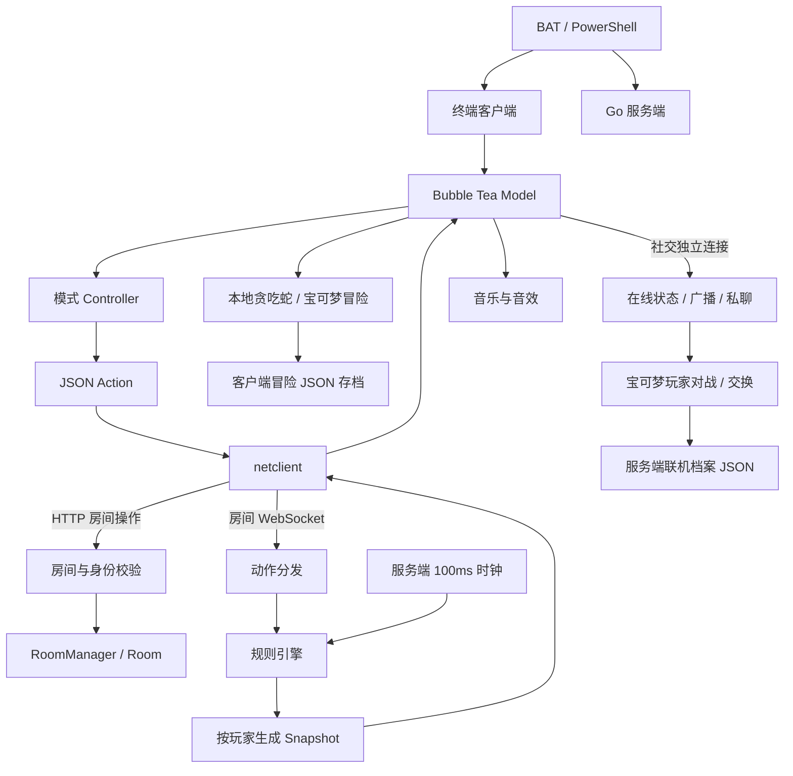

# 2026-10-26 全项目 Review 与框架梳理

## 最终结论

**本次范围修复并复核通过。** 新确认的四类 P2 缺陷（R1–R4）已完成最小修复和相关回归，未发现有充分证据支持的新增 P0/P1。最终全包测试/子测试 181 通过、0 失败、1 按设计跳过，语句覆盖率 51.8%；受影响四个包的竞态测试/子测试 68 通过、0 失败、1 跳过。小窗口保护不等于已经实现小屏布局，部分模式仍需放大；没有据此声称所有路径或使用场景全部验收。

## 范围和基线

对象是 `main` 上 `e817d1e1405b3eba2d3ae8d12d2463402b6d4304` 加当前工作区全部恢复与修复，不只看已提交的旧版本。当前有十二种游戏，其中十种走共享房间服务；贪吃蛇和宝可梦冒险本地运行，宝可梦玩家对战/交换另有服务端链路。

本轮按主要入口、模块调用和共享状态完成一次全项目评审；三个子任务覆盖宝可梦、共享网络/身份、终端/音频/启动，主任务核对各规则引擎、机器人入口及跨模块关系。检查调用和关键实现不等于逐行证明、全部玩法组合或设备验收。依赖源码及生成的事实表没有重新逐行审计，也未重新联网核实全部宝可梦原始数据。

上轮七类问题及恢复过程见[版本恢复与修复记录](recovery-and-fixes-2026-10-26.md)。本轮沿用这些问题的已验证状态，另记录下列新发现；修复后仅沿问题及受影响边界复核。

## 技术框架

这是 **Go 终端客户端 + Go HTTP/WebSocket 服务端 + 独立游戏规则包** 的结构。没有游戏网页前端，HTTP 主要用于大厅操作，WebSocket 用于状态和社交消息。

| 层次 | 代码入口 | 主要职责 |
| --- | --- | --- |
| 进程入口 | `cmd/table-card`、`cmd/table-card-server` | 解析参数，设置 Go 运行时预算，启动终端或服务端，管理进程生命周期 |
| 终端总控 | `internal/terminal/app` | Bubble Tea 事件处理、选模式/房间/对局页面、聊天、覆盖面板、离桌、离线游戏和音频协调 |
| 游戏控制器 | `internal/terminal/modes` | 将 Snapshot 渲染为终端界面，将按键/鼠标转为 Action；保存光标和选牌等本地状态 |
| 终端基础 | `internal/terminal/ui`、`profile` | ANSI 字符宽度、横纵排版、Controller 契约；玩家身份文件创建与读取 |
| 网络客户端 | `internal/terminal/netclient` | HTTP 请求、身份头、房间与社交双 WebSocket、关闭和重连 |
| 房间服务 | `internal/server`、`internal/table` | 房间、鉴权、准备/开局/离桌、动作路由、规则调度、在线玩家、聊天与战绩 |
| 联机冒险服务 | `internal/server/pokemon_social.go` | 宝可梦档案版本协调、双方邀请/确认、交换、对战副本及押金结算 |
| 游戏业务 | `internal/games` 和各游戏包 | 引擎注册/适配、状态机、合法动作、胜负/计分、每位玩家可见的快照和机器人决策 |
| 音频与运行时 | `internal/terminal/audio`、`internal/memory` | 内嵌音乐流式解码/重采样/切换、合成音效；GC、软内存预算和空闲回收 |
| 启动与分发 | 根目录 BAT/PS1、`scripts` | 源码构建、本机地址、后台服务、多开客户端、停止保护、便携 ZIP、校验及自动测试 |

主要库：Bubble Tea v2 负责事件循环，Bubbles v2 提供输入组件，Lip Gloss v2 和 ANSI 工具负责排版；`coder/websocket` 负责实时传输；Beep/oto 负责音频。版本依据本地 `go.mod`，不是本轮查询的最新版本推荐。

### 主要调用链

Controller 不负责裁定联网游戏的合法性。服务端 `games.Engine` 提供 `Mode / View / Apply`，还按能力使用 `Finished`、`BotAction`、`Tick` 等接口。客户端选牌/选格之后发送动作，服务端检验身份、成员关系及规则，再推送新的可见状态。

### 三类运行方式

| 方式 | 模式 | 调度和状态归属 |
| --- | --- | --- |
| 回合制房间 | 斗地主、酒馆、川麻、象棋、国际象棋、五子棋、围棋、UNO | 服务端保存权威规则状态；机器人经与真人相同的动作校验，每次行动通常留三秒思考间隔 |
| 实时房间 | 俄罗斯方块、草坪接力 | 服务端每 100ms 调度；按键和看规则不停止时钟；机器人/断线接管也由服务端调度 |
| 客户端本地 | 贪吃蛇、宝可梦冒险 | Bubble Tea 事件循环顺序修改状态，计时消息有局号/步号隔离；宝可梦玩家战另由服务端持有战斗副本 |

## 游戏模块索引与本轮覆盖

| 模式 | 规则/机器人位置 | 终端位置 | 本轮覆盖重点 |
| --- | --- | --- | --- |
| 斗地主 | `landlord`、`cards`、`bot/sunjiajia`、`games/landlord.go` | `modes/cards/landlord.go` | 叫分/底牌隐藏、出牌归属、牌型比较、倍数与机器人动作 |
| 骗子酒馆 | `liarbar`、`games/liarbar.go` | `modes/cards/liarbar.go` | 隐藏出牌、质疑、轮盘与淘汰、结果公示 |
| 四川麻将 | `mahjong` | `modes/mahjong` | 换牌/定缺、摸打响应优先级、补杠抢杠、血战与流局结算 |
| 中国象棋 | `chinesechess` | `modes/board` | 合法走子、将军/终局、重复局面与休闲长将规则 |
| 国际象棋 | `internationalchess` | `modes/board` | 升变、王车易位、吃过路兵、将死/和棋及重复局面键 |
| 五子棋 | `gomoku` | `modes/board` | 自由五子连线、认输/和棋、机器人合法推进 |
| 围棋 | `goengine` | `modes/board` | 提子/自杀/全局同形、双停、死子双确认/恢复与数子 |
| UNO | `uno` | `modes/cards/uno.go` | 叠罚/挑战、跳打、7/0、开局/双牌房规与累计积分 |
| 俄罗斯方块 | `tetris` | `modes/tetris` | 时间提速、软降与重力计时、锁定/触顶、同序列和同时淘汰 |
| 草坪接力 | `garden` | `modes/garden` | 死亡满血转移、同步胜负、实体容量、鼠标卡片/格子及房间状态传输 |
| 贪吃蛇 | `snake` | `app/snake.go` | 两次转向缓冲、边界/自身死亡、加速及暂停/旧计时隔离 |
| 宝可梦 | `pokemon`、服务端 `pokemon_social.go` | `app/pokemon*.go` | 命令/地图/剧情、战斗/捕获、经验/进化、存档、对战/交换同步及招式追踪 |

此表表示主要调用和关键实现已经核对；部分模式沿用已有行为测试，没有在本轮为每个规则分支新增测试。川麻、UNO 和中国象棋的房规差异以项目约定为准，没有将官方竞技玩法差异直接判为缺陷。

## 状态所有权与存储

| 状态 | 唯一主要写入方 | 生命周期/持久化 |
| --- | --- | --- |
| 页面、选牌、光标、输入框 | 客户端 Model/Controller | 当前客户端进程；不作为服务端出牌事实 |
| 房间成员和准备状态 | 服务端，跨房间操作经 `opMu` 协调 | 内存；离桌/断线接管、无人房间超时清理 |
| 联网规则引擎 | 服务端动作与时钟调度 | 内存；每个引擎有自己的锁，私有手牌按 viewer 过滤 |
| 房间/社交连接 | netclient 与服务端 hub | 两个独立连接；离桌不需要中断全服/私聊 |
| 玩家身份 | 客户端 profile | 配置目录的 JSON，随机 token 派生身份；完整文件原子发布 |
| 普通战绩 | 服务端 stats | `TABLE_CARD_DATA_DIR` 或服务端配置目录的 JSON |
| 本地冒险 | 客户端 pokemon.Game | 按昵称的存档，临时文件写入后替换，读取校验和迁移 |
| 联机档案/金币/交换结果 | 服务端 pokemonSocialStore | 联机档案 JSON、版本号、押金/结果恢复；客户端同步后应用结果 |

身份是持有 token 的本地身份，不是账号密码系统。默认房间连接面向可访问的本机/局域网服务；这轮不将其描述为具有互联网账号平台的保护能力。宝可梦联机对战有服务端裁判和结算，但本地冒险导入并非完整反作弊体系。

## 新问题清单及最小方案

### R1 · P2：房间消息上限与合法状态容量冲突

- 根因位置：`internal/terminal/netclient/client.go` 的 `Connect`，原来没有为房间 WebSocket 设置读取上限，采用库默认的 32KB；社交连接已经有更大的显式预算。
- 触发：游戏快照加房间信息超过 32KB。草坪定义允许全局 120 个僵尸、每草坪 256 弹丸和 45 格植物；容量边界快照实际编码为 35,882B。
- 影响：客户端 `Read` 返回 message too big，合法大状态触发断线/重连，而不只是渲染变慢。
- 复现：使用真实 WebSocket 和 netclient 读取容量快照，旧实现失败。另采样 12 场机器人比赛最大 18,385B，不能据此宣称自然局必然出现该问题。
- 最小方案及实施：房间连接显式设置 **2MiB 有界限读**，容纳现有 HTTP 房间选项预算和规则快照，不修改字段或握手协议；超过该界限仍拒绝。
- 验证：`client_test.go` 检查合法容量解码和大于 2MiB 的拒绝，netclient 常规与竞态定向测试通过。

### R2 · P2：原创专属技没有正确的内部编号

- 根因位置：`internal/pokemon/data.go:48` 初始化原创 Move 时缺少 ID，151 个技能默认 ID 都为 0。
- 触发：学习和使用原创专属技后，对手使用定身法、鹦鹉学舌、模仿等依赖上一招的操作。
- 影响：LastMove 被记录为撞击，而非实际技能；封锁或复制目标错误。
- 复现：皮卡丘实际使用“雷光跃动”，旧实现 LastMove 为 1，正确为 51；所有原创技能的索引一致性检查也失败。
- 最小方案及实施：初始化填入已有稳定索引 `25 + species`，不改存档格式、技能表布局和外部接口。
- 验证：新增 `signature_tracking_test.go`，覆盖教学、实际出招、定身法、鹦鹉学舌和全部 151 个原创技 ID；相关新旧战斗回归定向通过。

### R3 · P2：完整终端帧缺少高度保护

- 根因位置：`internal/terminal/app/app.go` 的整体 View/gameView 组合，以及卡牌控制器按宽度生成多组手牌；分配给控制器的高度未覆盖额外标题/状态/帮助，最后也没有完整帧高度检查。
- 触发实测：90×30 下斗地主首局 38 行、围棋 33 行、UNO 31 行；80×30 下 UNO 36 行。此前宽度测试不能发现超高。
- 影响：终端会截去部分牌面、状态或提示；隐藏内容还可能继续接收鼠标。实际设备鼠标错位未做真人验收，不写成已经复现。
- 最小方案：超高时显示明确的所需窗口尺寸和实时对局仍在继续的提示，放大后恢复原布局，并禁止隐藏棋盘接收点击。保留全部真实手牌状态，不通过尾部截断伪造可用画面，也不在本轮引入新的全局滚动交互。
- 实施位置：`app.go:857` 完整帧高度判定、`:870` 尺寸提示，鼠标入口和首页/房间/对局动作入口保护。超高时没有删除原始手牌或改动规则状态；窗口扩大后自动恢复。
- 验证：新增三项测试覆盖多模式/尺寸、完整模式首页及等待房、隐藏鼠标阻断和 Del 退出；原草坪完整界面选卡种植及宽度回归继续通过。**90×30 斗地主仍需至少 38 行，此修复没有实现小屏滚动或分页。**

### R4 · P2：兼容房间聊天通过两条连接重复送达

- 根因位置：`internal/server/realtime.go:210` 的旧房间 chat 分支，原来同时向 room 和 social 广播；当前 Model 收到任一通道的 chat 都追加记录。
- 触发：通过仍受支持的房间 chat 入口发消息，接收者同时连接房间和社交两条流。并不要求修改聊天文字或绕过身份。
- 影响：接收者显示两份相同房间消息，房间回退消息还缺少 roomCode，跨通道的消息归属信息不一致。
- 二次核实：同一接收身份在两条服务端发送队列收到 2 copies；旧实现新增回归失败。检查 app 两处聊天处理确认会各追加一次。
- 最小方案及实施：按接收身份优先成功投递 social，失败或没有 social 时回退 room；保留有界队列和慢连接取消，并统一原本已有的 scope/roomCode 元数据，不新增协议字段。
- 验证：新增 `realtime_test.go` 检查正常 social 单投递、social 队列满时回退 room，并复核真实 WebSocket 生命周期、跨模式消息隔离及房间归属测试，常规和竞态检查通过。

## 跨模块接缝与整理建议

这些是后续可选方向，不作为已实施的新功能：

1. **先把终端布局预算作为明确契约。** R3 暴露了“控制器局部可放下，完整帧却放不下”的问题。后续若要真正支持更小窗口，可逐模式做紧凑布局/手牌分页；须保护卡片位置、聊天输入和鼠标命中，而不是只把字符串裁短。
2. **收拢游戏注册元数据。** 模式 ID、服务端模式表、引擎 Registry、终端 Registry、音乐和启动版本分散维护。新增草坪时需同时修改多处；先补注册一致性检查，再考虑统一元数据。规则引擎与控制器仍应分开，不把界面依赖引入业务包。
3. **明确机器人实际入口，再做性能优化。** 斗地主实际调用 `bot/sunjiajia.Agent`；酒馆运行策略在 `games/liarbar.go`，而 Agent 还保留两项没有调用者的酒馆策略。先决定保留哪套策略及其行为测试；界面优化再依据已有渲染分配热点，避免无依据重构。

共享 `Server.opMu` 保证多房间行为顺序，但也让房间操作、机器人规划和部分落盘串行。它是需要负载证据后再优化的结构约束，本轮没有把它当成已证实的性能故障。社交会话上限 256 是代码容量限制，不是“已验证支持 256 人同时游戏”；没有新增并发能力承诺。

## 验证边界和交付状态

前置复用的最近全包结果：170 个测试/子测试通过、0 失败、1 按设计跳过，语句覆盖率 51.0%；同范围竞态、vet 和 Windows PowerShell 5.1 启动/停止检查通过。覆盖率只证明执行到的语句，不证明所有规则组合或交互成立。

本轮新增缺陷均先检查真实调用链并复现，再做最小修复；后续只核对清单、相关回归和共享边界，没有重新开启第二轮全项目评审。

最终实际执行：

| 检查 | 结果 |
| --- | --- |
| `go test -json -count=1 -timeout=90s -coverprofile=runtime/full-review-20261026/coverage.out ./cmd/... ./internal/...` | 181 个 pass、0 fail、1 skip；语句覆盖率 51.8% |
| `go test -race -json -count=1 -timeout=90s ./internal/server ./internal/terminal/netclient ./internal/terminal/app ./internal/pokemon` | 68 个 pass、0 fail、1 skip，无 Go 竞态诊断 |
| 客户端/服务端本地 EXE 构建，`go vet ./...`、`git diff --check` | 通过 |
| Windows PowerShell 5.1 启动/停止和编码兼容 | 复用本日之前已通过的启动/停止结果；本轮没有改动运行入口行为 |

测试统计包含子测试；skip 是需要独立入口的内存采样助手。本轮没有重新测内存，也未宣称内存降低或性能提升。覆盖率受游戏随机分支影响，不把差值视为优化收益。

日志：`runtime/full-review-20261026/full-tests.jsonl`、`race-tests.jsonl`、`coverage.out`。本轮 Review 结束时没有远端提交、PR、合并或发行操作，也没有安排真人/手动体验验收。此前源码备份是本轮 Review 修复前的快照，不包含这些后续改动。

## 源码提交前复核

随后用户明确要求测试、复核后提交至既有 GitHub 仓库。本次沿用 R1–R4 及之前恢复修复的清单核对，没有再开启一轮完整全项目审查，未确认新的阻断缺陷。

- 再次执行全包常规测试、`go vet` 和全包竞态检查，通过；源代码范围与上述 181 项测试/子测试相同，内存采样助手仍按设计跳过。
- 再次直接执行 `scripts/test-launchers.ps1`：14 个脚本 Windows PowerShell 5.1 编码/语法、两种 PowerShell 停止方式、进程身份保护与十模式服务检查通过，测试服务已停止。
- 最初将包含启动测试的整套输出重定向到文件，后台进程继承输出句柄导致等待；清理该次测试服务后，改为不重定向启动测试而通过。失败捕获记录留在本地 `runtime/pre-push-20261026/verification.txt`，不将该次调用误报为整套成功。
- 源码交付范围为当前分支的恢复代码、修复、回归测试和文档；不包含 bin、dist、runtime、玩家身份/存档及本地个人约定。仓库中没有 GitHub Actions 工作流，本次不创建 PR、标签或 Release。
